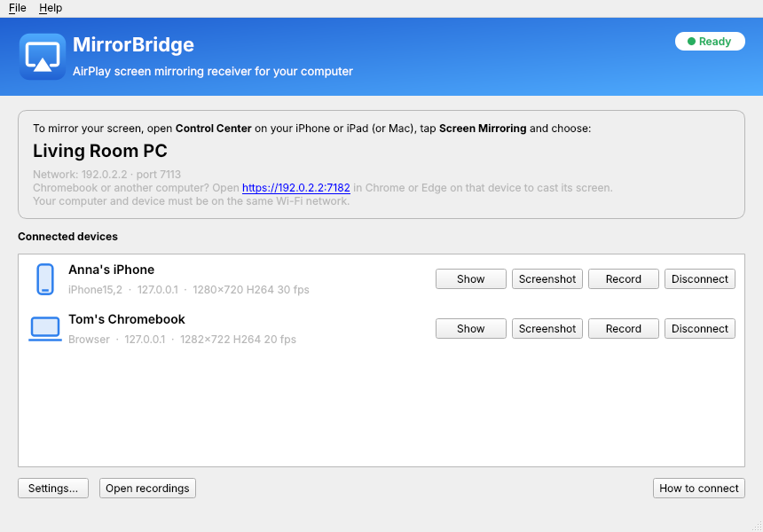
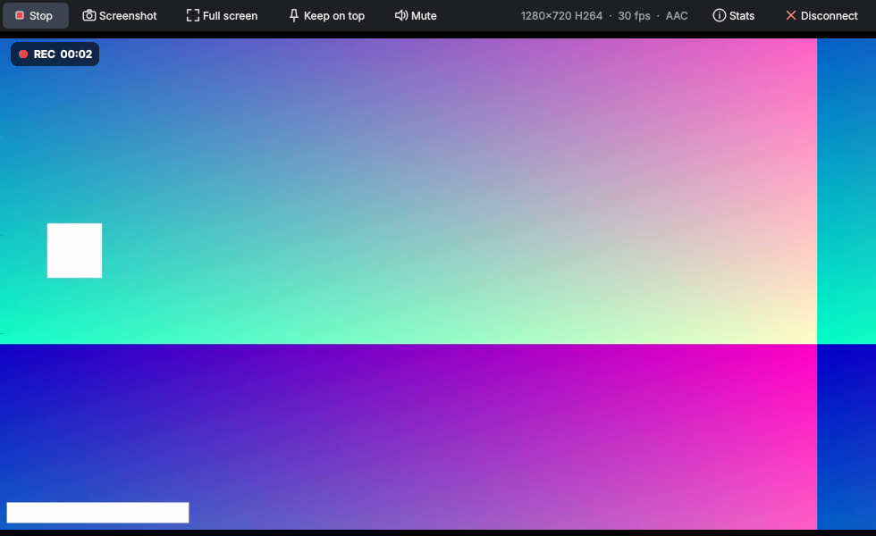
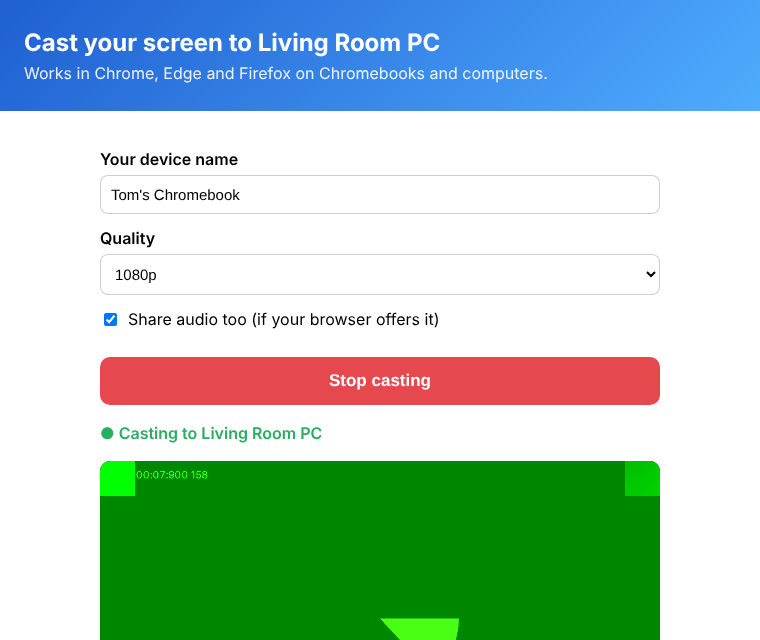

# MirrorBridge

[](https://github.com/hktvst9876/MAC---windows-/actions/workflows/build.yml)

**An AirPlay screen-mirroring receiver for Windows and macOS.** Mirror the screen of an iPhone, iPad or
Mac to your computer, play AirPlay audio, record what you see (with an optional microphone voice-over),
and take screenshots. Chromebooks and other computers can cast to it from a web browser.



## Features

- **AirPlay screen mirroring** from iPhone, iPad and Mac (Control Center → Screen Mirroring).
  H.264 video, and H.265 for 4K on devices that support it.
- **AirPlay audio** (music from the Music app and other apps), with cover art and track info.
- **Several devices at once**, each in its own window. Full screen, keep-on-top, mute.
- **Recording to MP4** (H.264 + AAC) with one click, optionally mixing in a **voice-over from the
  microphone**. Rotating the phone mid-recording is handled (the picture is letterboxed).
- **Screenshots** to PNG at full resolution.
- **Browser casting**: a Chromebook or any computer with Chrome/Edge/Firefox opens a web page served by
  MirrorBridge and casts its screen (and tab/system audio) to it.
- **Password protection**, receiver name, resolution (720p / 1080p / 1440p / 4K), 30/60 fps,
  hardware decoding, audio output and microphone selection.

| Mirroring window | Browser casting page |
| --- | --- |
|  |  |

The screenshots show the built-in test pattern (Help → *Send a Test Stream*).

## Download and install

Builds for Windows (installer and zip) and macOS (Apple Silicon and Intel `.dmg`) are produced by
GitHub Actions for every push: open the **Actions** tab → latest *Build* run → *Artifacts*. Tagging a
commit `vX.Y.Z` publishes them as a GitHub Release.

- **Windows 10/11**: run `MirrorBridge-…-windows-setup.exe`. The installer adds a Windows Firewall rule
  so devices on your home network can connect. (With the zip version, click *Allow access* when Windows
  asks.) The builds are not code-signed, so SmartScreen may warn: *More info → Run anyway*.
- **macOS 11+**: open the `.dmg` and drag MirrorBridge to Applications. The app is not notarized, so the
  first time right-click it → *Open* (or run `xattr -dr com.apple.quarantine /Applications/MirrorBridge.app`).
  Allow *Local Network* access and incoming connections when asked.

## How to connect

Your computer and the device must be on the **same network**.

| Device | How |
| --- | --- |
| iPhone / iPad | Open **Control Center** → **Screen Mirroring** → choose your MirrorBridge name. |
| Mac | **Control Center** in the menu bar → **Screen Mirroring** → choose MirrorBridge. |
| Music / audio | Tap the **AirPlay** icon in the Music app (or any audio app) → choose MirrorBridge. |
| Chromebook, Windows, Linux, Mac (browser) | Open the `https://…:7180` address shown in the main window in Chrome or Edge, accept the certificate warning once, click **Start casting**. |

Shortcuts in a mirroring window: **F** full screen, **Esc** leave full screen, **R** record,
**S** screenshot, **M** mute, **T** keep on top, **I** statistics. Closing the window disconnects that
device. Recordings go to `Videos/MirrorBridge` (Windows) or `Movies/MirrorBridge` (macOS), screenshots
to `Pictures/MirrorBridge`; both folders can be changed in Settings.

## What it cannot do (and why)

- **Google Cast is not supported.** Chrome and Android only cast to receivers that hold a device
  certificate signed by Google, which is only issued to licensed hardware makers. No independent app can
  legitimately be a Google Cast receiver. Browser casting covers Chromebooks and computers instead.
- **Android phones**: phone browsers do not allow web pages to capture the screen. On Windows, many
  Android phones can mirror with Miracast ("Smart View", "Screen cast") to Windows' own *Wireless
  Display* feature (Settings → System → Projecting to this PC).
- **DRM-protected video** (Netflix, Apple TV+, …) is blacked out by iOS itself during mirroring.
- **AirPlay "video casting"** (sending a YouTube/HLS video URL rather than mirroring the screen) is not
  implemented; use screen mirroring.

## Troubleshooting

- **The receiver does not appear in Screen Mirroring**: check both devices are on the same Wi-Fi (not a
  guest network), that the firewall allows MirrorBridge (Windows: the network must be set to *Private*),
  and that the router does not isolate clients ("AP isolation"). VPNs can also block discovery.
- **Choppy video**: use 1080p and 30 fps in Settings → Video, prefer 5 GHz Wi-Fi or Ethernet for the
  computer, and enable hardware decoding for 4K/H.265.
- **Check the receiver without a phone**: Help → *Send a Test Stream* streams a test pattern with sound
  through the complete AirPlay path (handshake, encryption, decoding, display).
- **Logs**: Help → *Open Log Folder* (`%APPDATA%\MirrorBridge` on Windows,
  `~/Library/Application Support/MirrorBridge` on macOS).

## Run from source

Requires Python 3.10+.

```sh
pip install -r requirements.txt
python -m mirrorbridge            # options: --name "My PC"  --port 7100  --debug
```

On Linux, also install PortAudio (`libportaudio2`) for sound.

### Tests

```sh
pip install pytest
python -m pytest
```

The test suite covers the FairPlay decryption against vectors produced by the original C code, the full
AirPlay session (pairing, FairPlay handshake, key derivation, encrypted video and audio) using a
simulated sender, audio codecs, recording, browser casting over TLS/WebSocket, and the whole application
driven through its UI. If Playwright and Chromium are installed, a real browser casts to the app too.

`python -m mirrorbridge.testing.fake_sender --host <ip> --port 7100` streams a test pattern to any
running receiver.

### Build the apps yourself

```sh
pip install pyinstaller
python tools/make_icons.py
# macOS only: iconutil -c icns packaging/icons/MirrorBridge.iconset -o packaging/icons/MirrorBridge.icns
pyinstaller --noconfirm packaging/mirrorbridge.spec      # -> dist/MirrorBridge(.app)
# Windows installer (Inno Setup 6): ISCC packaging\windows\installer.iss
```

## How it works

| Part | Where |
| --- | --- |
| Bonjour advertisement (`_airplay._tcp`, `_raop._tcp`) | `mirrorbridge/airplay/mdns.py` |
| RTSP control connection, SETUP, volume, metadata | `mirrorbridge/airplay/server.py` |
| Pairing (Ed25519 / X25519) | `mirrorbridge/airplay/pairing.py` |
| FairPlay handshake and key decryption (pure-Python port of *playfair*) | `mirrorbridge/airplay/fairplay.py`, `mirrorbridge/airplay/playfair/` |
| Mirrored video stream (AES-CTR, H.264/H.265) | `mirrorbridge/airplay/mirror.py` |
| Audio stream (RTP, AES-CBC, AAC-ELD/ALAC/AAC, retransmission) | `mirrorbridge/airplay/audio.py` |
| Decoding, playback, recording (FFmpeg via PyAV, PortAudio) | `mirrorbridge/media/` |
| Browser casting (HTTPS page, WebSocket, WebM) | `mirrorbridge/webcast/` |
| User interface (Qt / PySide6) | `mirrorbridge/ui/` |

MirrorBridge announces itself as an Apple TV (model `AppleTV3,2`) using the AirPlay protocol as
documented and implemented by the open-source [UxPlay](https://github.com/FDH2/UxPlay) and RPiPlay
projects. It listens on port 7100 by default so it does not clash with the AirPlay receiver built into
recent versions of macOS (port 7000).

## License and credits

MirrorBridge is free software under the **GNU General Public License v3.0** (see `LICENSE`). If you
distribute it, or a modified version, you must also make the source code available under the same
license.

The AirPlay protocol support follows UxPlay (GPL-3.0), RPiPlay and shairplay (LGPL-2.1). The FairPlay
key decryption is a port of *playfair* by EstebanKubata (GPL-3.0); its lookup tables are included in
`mirrorbridge/airplay/playfair/tables.py`. MirrorBridge uses FFmpeg (through PyAV), Qt (through
PySide6), PortAudio, python-zeroconf and cryptography.

AirPlay, Apple TV, iPhone, iPad and Mac are trademarks of Apple Inc. Google Cast and Chromebook are
trademarks of Google LLC. MirrorBridge is not affiliated with or endorsed by Apple or Google.
